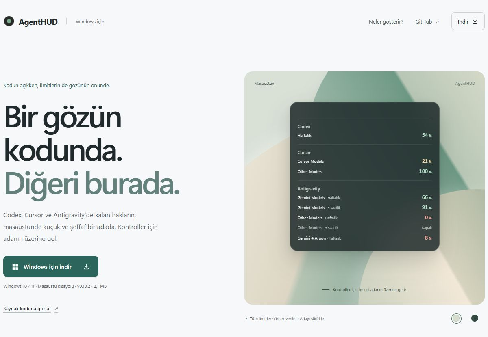

<h1 align="center">AgentHUD</h1>

<p align="center">Codex, Cursor ve Antigravity limitlerin, masaüstünde küçük bir adada.</p>

<p align="center">
  <a href="https://github.com/serhatkochan/agenthud/releases/latest/download/AgentHUD-Setup.exe"><strong>Windows için indir</strong></a> ·
  <a href="https://agenthud.serhatkochan.com">Web sitesi</a> ·
  <a href="https://github.com/serhatkochan/agenthud/releases">Sürümler</a>
</p>



AgentHUD, AI araçlarında **ne kadar hakkın kaldığını** aynı yerde gösteren kompakt bir Windows uygulamasıdır. Şeffaf ada diğer pencerelerin üzerinde durur. Yatay özetle açılır; üzerine gelince görünen **+** bütün limitleri gösterir, **−** yeniden küçültür. İstediğin yere sürükle; koduna devam et.

Arayüz Rust ve Windows API ile çizilir. Çalışırken Electron, WebView veya Node süreci açılmaz.

> Görseller, örnek verilerle hazırlanmış web önizlemesidir. Gerçek uygulama, kendi hesabından dönen ölçümleri gösterir. [Sitedeki + / − düğmesiyle iki görünümü de deneyebilirsin.](https://agenthud.serhatkochan.com)

## İndir ve kullan

1. [AgentHUD-Setup.exe’yi indir](https://github.com/serhatkochan/agenthud/releases/latest/download/AgentHUD-Setup.exe) ve kurulumu tamamla. Windows 10 / 11, x64. Masaüstünde oluşan **AgentHUD** kısayolundan açabilirsin.
2. Cursor’da ve Codex uygulamasında veya CLI’da hesabına giriş yapmış ol. Codex plan limitleri için ChatGPT hesabıyla giriş gerekir; yalnızca API anahtarı yeterli değildir.
3. Antigravity limitlerini de görmek için Antigravity’yi açık tut ve hesabına giriş yap.

Ada ilk açılışta ekranın sağ üstünde yatay özet olarak görünür. İmleci üzerine getirince **+**, **−** ve **×** kontrolleri görünür. **+** bütün limitleri açar, **−** yeniden küçültür. Boş bir yerinden sürükleyerek taşıyabilir, **×** ile kapatabilirsin. Pencere odaktayken Space veya Enter görünümü değiştirir; Escape bütün limitleri açar. Haklar **60 saniyede bir** yenilenir. Ayrı bir AgentHUD hesabı veya elle API anahtarı girişi gerekmez.

Uygulama görev çubuğunda yer kaplamaz. **× uygulamayı tamamen kapatır**; yeniden açmak için masaüstü kısayolunu kullan.

Kurulum yalnızca mevcut kullanıcıya, varsayılan olarak `%LOCALAPPDATA%\Programs\AgentHUD` klasörüne yapılır. Masaüstü ve Başlat menüsü kısayolları oluşturulur. Windows’un uygulama kaldırma listesinden kaldırabilirsin. Windows açılışında otomatik başlatma eklenmez.

Kurulumsuz kullanım için [AgentHUD.exe](https://github.com/serhatkochan/agenthud/releases/latest/download/AgentHUD.exe) de sürüm dosyalarında bulunur.

### Küçük görünümde hangi hak seçilir?

| Gösterge | Seçilen limit |
| --- | --- |
| **Codex** | Varsa 5 saatlik pencere; yoksa haftalık limit. |
| **Cursor Models** | Yalnızca Cursor Models havuzu. Other Models onun yerine kullanılmaz. |
| **Gemini** | Antigravity Gemini grubunun varsa 5 saatlik, yoksa haftalık limiti. |
| **Argon** | Varsa 5 saatlik limit; yoksa mevcut haftalık limit. |
| **Other Models** | Antigravity Other Models grubunun varsa 5 saatlik, yoksa haftalık limiti. |

Kısa penceresi bulunmayan bir Antigravity grubunda mevcut haftalık limit gösterilir. **Bir grubun haftalık hakkı tükenmişse, küçük görünümde o grup %0 olur**; kısa pencerenin %100 dönmesi kullanılabilir hak olarak sunulmaz. Devre dışı bir pencere ise “kapalı” görünür. Eksik ölçümler %0’a çevrilmez.

## Hangi limitleri gösterir?

Yüzdeler **kalan hakkı** gösterir. Örneğin `%20`, o kullanım havuzunun %20’sinin kaldığı anlamına gelir. Bir aracın farklı havuzları tek yüzdeye düşürülmez.

| Araç | Ayrı ayrı gösterilen ölçümler |
| --- | --- |
| **Codex** | Hesabın döndürdüğü 5 saatlik, haftalık veya aylık kullanım pencereleri. |
| **Cursor** | **Cursor Models** ve **Other Models** kullanım havuzları. |
| **Antigravity** | Gemini Models, Other Models (Claude/GPT), Gemini 4 Argon ve servisin döndürdüğü diğer gruplar. Her grubun haftalık ve 5 saatlik pencereleri ayrı satırlarda. |

Sıra yukarıdan aşağı **Codex → Cursor → Antigravity**. Her hesap aynı pencere ve model gruplarını sunmaz. Veri dönmeyen bir limit için yüzde uydurulmaz; devre dışı pencereler soluk görünür.

Ayrı bir Claude hesabı bağlantısı bu sürümde bulunmuyor. Antigravity’nin Other Models satırındaki Claude/GPT hakkı, Antigravity’ye ait kullanım havuzudur; Claude hesabındaki limit ayrı tutulur.

## Boyut ve bellek

| Ölçüm | Değer |
| --- | --- |
| v0.10.2 kurulum EXE’si | Yaklaşık **2,1 MB** |
| Uygulama EXE’si | Yaklaşık **5,2 MB** |
| Çalışma kümesi (RAM) | Bu cihazdaki ölçümlerde yaklaşık **19–21 MB** |
| Özel bellek (private bytes) | Aynı ölçümlerde yaklaşık **4–5 MB** |

Bellek ölçümü 29 Ekim 2026’da çalışan Windows uygulamasından alındı. Çalışma kümesi, özel bellek ve dosya boyutu farklı ölçümlerdir. RAM tüketimi Windows’a, yenileme anına ve çalışma süresine göre değişir; bu değerler sabit bir üst sınır değildir.

## Oturum ve veri akışı

AgentHUD, mevcut uygulama oturumlarını cihazdan okur:

| Araç | Oturum kaynağı | Kullanım sorgusu |
| --- | --- | --- |
| Cursor | Yerel `state.vscdb`, salt okunur erişim | Doğrudan `cursor.com` kullanım servisi |
| Codex | `CODEX_HOME/auth.json` veya `%USERPROFILE%\.codex\auth.json` | Doğrudan `chatgpt.com` kullanım servisi |
| Antigravity | Çalışan dil sunucusu | Cihazdaki yerel kullanım servisi |

Kota sorguları için bir AgentHUD sunucusu bulunmaz. Oturum bilgileri arayüzde gösterilmez. Uygulama, sağlayıcıların kullanım servislerine ve yerel oturum biçimlerine bağlıdır; bunlar değiştiğinde bağlantıların güncellenmesi gerekebilir.

## Bir limit görünmüyorsa

- **Giriş gerekli:** İlgili uygulamada yeniden giriş yap. Codex için ChatGPT hesabını kullan.
- **Bağlantı yok:** İnternet bağlantını ve sağlayıcının durumunu kontrol et. Uygulama sonraki yenilemede tekrar dener.
- **Antigravity görünmüyor:** Antigravity’nin çalıştığını ve oturumunun açık olduğunu kontrol et.
- **Beklediğin bir pencere eksik:** Hesabın veya sağlayıcının yanıtı o pencereyi sunmuyor olabilir. Planına göre gösterilen gruplar değişebilir.

## Kaynak koddan çalıştır

Windows, Rust MSVC araç zinciri ve Visual Studio C++ Build Tools / Windows SDK gerekir. WebView2 veya Node.js gerekmez.

```powershell
git clone https://github.com/serhatkochan/agenthud.git
cd agenthud

# Geliştirme sürümünü aç
cargo run --manifest-path src-tauri/Cargo.toml

# Rust testlerini çalıştır
cargo test --manifest-path src-tauri/Cargo.toml

# Taşınabilir Windows uygulamasını derle
cargo build --release --manifest-path src-tauri/Cargo.toml
```

Çıktı: `src-tauri/target/release/agenthud.exe`.

Kurulum paketi için NSIS 3 gerekir. Paketleme komutu `release/AgentHUD-Setup.exe`, `release/AgentHUD.exe` ve `release/SHA256SUMS.txt` üretir:

```powershell
.\scripts\package-windows.ps1

# Kurulum / kaldırma ve kısayol kontrolü; masaüstü yerine yalıtılmış test klasörü kullanır.
.\scripts\test-installer.ps1 -Makensis 'C:\Program Files (x86)\NSIS\makensis.exe'
```

`src-tauri` klasör adı eski Tauri sürümünden kalır; güncel uygulama doğrudan Windows API kullanır.

```text
site/                         Statik tanıtım sayfası
src-tauri/src/bar.rs           Şeffaf Windows adası ve otomatik yenileme
src-tauri/src/bar/paint.rs     Yerel arayüz çizimi
src-tauri/src/quota_view.rs    Küçük görünümde limit seçimi
src-tauri/src/providers.rs     Kota okuma ve sağlayıcı bağlantıları
src-tauri/src/system.rs        Yerel süreç / port keşfi
src-tauri/src/models.rs        Veri yapıları
```

Tanıtım sayfası `site/` içindeki HTML, CSS ve JavaScript dosyalarından oluşur; derleme adımı yoktur. Vercel, `vercel.json` üzerinden bu klasörü yayınlar.

Sürüm notları [CHANGELOG.md](CHANGELOG.md) içinde. İndirme sayfasındaki `SHA256SUMS.txt`, yayınlanan EXE’nin dosya bütünlüğünü doğrulamak için kullanılabilir.

---

[Serhat Kochan](https://serhatkochan.com) tarafından geliştirildi. AgentHUD bağımsız bir projedir; OpenAI, Cursor veya Google’ın resmi ürünü değildir.
